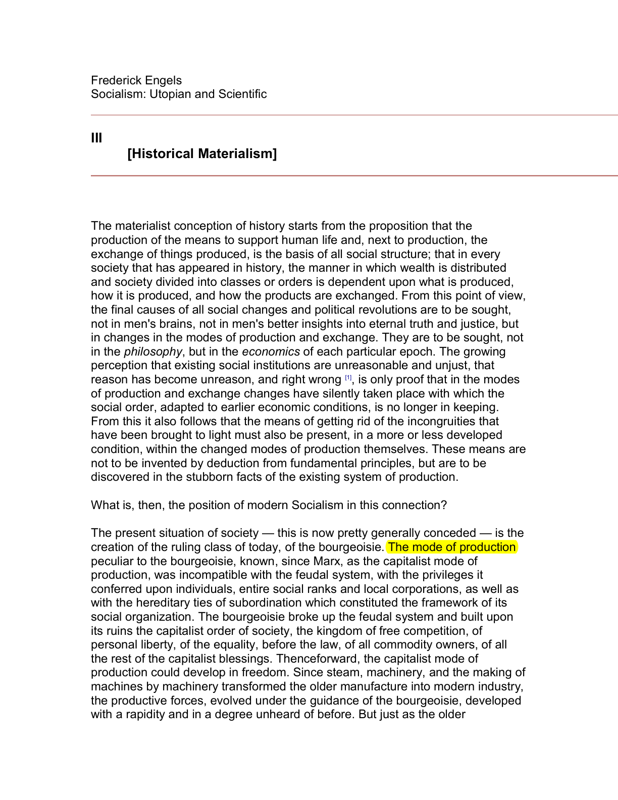

# Source my stuff

Basically I upload PDFs and then it does a vector search to find which pages are most similar to my query.
I had to chunk PDFs as well for this and take note of which page they were on. 

EX: 

So yeah, helped me a lot with history class. 

### technologies used:

- Python
- Streamlit (web UI)
- ChromaDB (vector store)
- LangChain (`langchain-chroma`, `langchain-ollama`, `langchain-text-splitters`, `langchain-core`)
- Ollama (serves the `embeddinggemma` embedding model)
- PyMuPDF (PDF text extraction and page highlighting)

